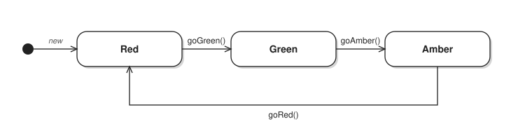
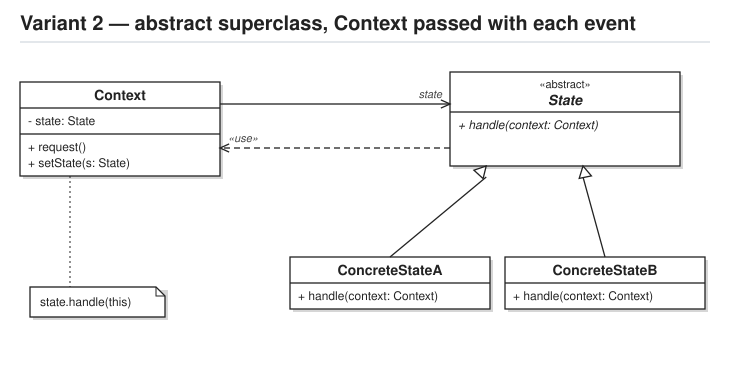

# Question 1

## the state chart to implement

Traffic light state chart


Events:

- `goGreen()` - "goGREEN" message received
- `goAmber()` - "goAMBER" message received
- `goRed()` - "goRED" message received

An event that isn't valid in the current state (e.g. `goAmber()` while RED) must leave the state unchanged,
and print a message saying why.

## the state pattern variant to demonstrate

Variant 2: `State` is an **«abstract»** superclass, and each state (`RedState`, `GreenState`, `AmberState`) is a
**subclass** of it. The states do **not** store the context: the `TrafficLight` passes **itself** as a parameter
with every event (e.g. `this.state.goGreen(this)`), and the state calls `setState(...)` on the light it was given.



## `main.ts` - sample text-driven menu

You have been provided with a sample main.ts for a text-driven menu to interactively drive your implementation

The terminal output should look something like the following:

```bash
question1 % deno run src/main.ts
---------------------------
State: RED

1 - goGreen
2 - goAmber
3 - goRed
q - quit
> 2
You can't go AMBER from RED - the light must go GREEN first
---------------------------
State: RED

1 - goGreen
2 - goAmber
3 - goRed
q - quit
> 1
The light changes to GREEN
---------------------------
State: GREEN

1 - goGreen
2 - goAmber
3 - goRed
q - quit
> 
```

# Question 2

create a copy of your question 1 project, and implement the following additional functionality:

- add a new state 'FlashingAmber', used when the lights are out of order
- add a new event `goFlashing()`: from ANY of the RED, GREEN or AMBER states it moves the light to 'FlashingAmber'
- from 'FlashingAmber', `goRed()` moves the light back to RED; every other event leaves it flashing
- add a menu option to `main.ts` for the new event
