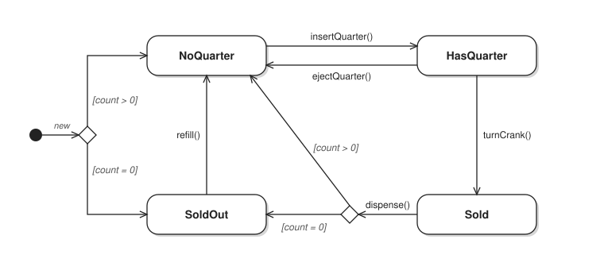
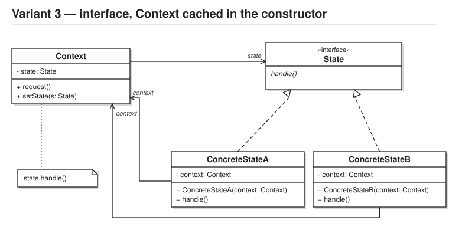

# Question 1

## the state chart to implement

Gumball machine state chart


## the state pattern variant to demonstrate



## `main.ts` - sample text-driven menu

You have been provided with a sample main.ts for a text-driven menu to interactively drive your implementation

The terminal output should look something like the following:

```bash
question1 % deno run src/main.ts
---------------------------
State: NO_QUARTER
Gumballs: 2

1 - insert a quarter
2 - eject the quarter
3 - turn the crank
4 - refill with 5 gumballs
q - quit
> 1
You inserted a quarter
---------------------------
State: HAS_QUARTER
Gumballs: 2

1 - insert a quarter
2 - eject the quarter
3 - turn the crank
4 - refill with 5 gumballs
q - quit
> 
```

# Question 2

create a copy of your question 1 project, and implement the following additional functionality:

- when dispensing a gumball from the 'sold' state, add a 10% chance that 2 gumballs are dispensed
- since that means that we need at least 2 gumballs in the machine:
    - change the 'SoldOut' state to 'InsufficientGumballs', 
    - and make the guard condition 'count > 1' for both choice diamonds